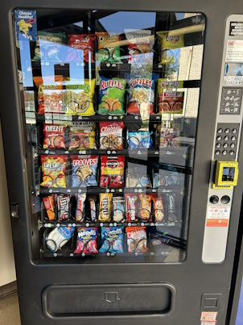

# Project 3 Vending Machine
## CYB-2004 Fall 2026



*Campus services need your help!* All the vending machine firmware was lost in a ransomware attack, and they need you to write new software for the vending machines!  Luckily, they saved all of their inventory in nicely formatted JSON files (that the malicious attackers failed to secure).  They just need the transaction log at the end of the day to keep the accountants happy and the money flowing in.  We always like to under-promise and over-deliver, so feel free to add additional features for increased clout (and bonus points).  The requirements list is daunting, so don't delay, but relax and enjoy some Nerds Gummy Clusters or some Cheetos while you work.  

### Requirements
1. Read inventory from **tu_vending_inventory.json** (the price_usd is the price in US Dollars $)
2. Assign the inventory to a Vending Location (Grid layout A1, A2, A3, A4, A5, B1, B2, B3, etc.). There are 30 items in the inventory, so a grid of 5x6 or 6x5 works nicely)
3. Interactive vending machine, continues until the user quits
4. Sell items, keeping track of available inventory.
5. You can't sell items that are out of stock (0 inventory)
6. When the user quits, print out the sales total as part of the goodbye message
7. Save the ending inventory status (to *original* JSON **format** (it doesn't have to be the same actual file, but it could be) or database)
8. Saves the list of transactions to a CSV file OR to a database. Your CSV header row *might* look like this:

    `SLOT_ID,AMOUNT_USD,ITEM`
9. Has at least two (2) Unit Tests that test a component that you have written 
(could be testing that the currency exchange rate calculation was done correctly, or that when a transaction is done, it is correctly stored in your transaction log, or tests that when an item is sold, it is correctly accounted for in your virtual vending machine, or makes sure the total does not increase when an out-of-stock item is purchased)
10. Your final code *must* be **pushed** to github.  If you are in doubt, please test it now (change this file, and push it back to GitHub to prove you know how to do it)
11. You also must submit the project on Harvey.

## **YOU MUST IMPLEMENT AT LEAST ONE OF THE FOLLOWING THREE FEATURES**
- Save transactions and/or inventory to a SQLite database
- Generate a BAR Chart showing current inventory levels when selected as an option during the vending loop
- Switch between USD (US Dollar, default), CAD (Canadian Dollar), JPY (Japanese Yen), and EUR (Euro) by using the JSON api from https://exchangeratesapi.io/ [^1][^2]

[^1]: You will need to sign up for a *FREE* account to use the API, and include the API key in your API calls.  If you choose this route, please feel free to **not** include your API key for security purposes; I can use mine for grading.
[^2]: The api has exchange rates pegged to the EURO, so watch your currency conversions 

**FOR BONUS POINTS (EXTRA CREDIT) YOU MAY IMPLEMENT ADDITIONAL FEATURES**
*10 points for each additional feature, for a total of 20 potential bonus points*

Hints and things to think about
- Start at the beginning 
- Should an item still display if it is sold out?
- What happens if someone tries to buy something that is sold out?

---
## Sample Output (yours may be different based on what features you implement)
```
 >Welcome to the TU Vending Machine!
 >Please choose from the following options:
 > (d) Display items
 > (p) Purchase item
 > ($) Change currency
 > (c) Generate inventory chart
 > (q) Quit
 > d
 > -------------------------
 > A1 $2.00 Funions
 > A2 $2.25 Salt and Vinegar potato chips
 > A3 $2.50 Cheddar Sun Chips
 > A4 $2.00 Jalepeno Cheetos
 > A5 $2.50 Cheetos
 > B1 $2.00 Potato Skins Chips

 etc....(you get the point, I'm not going to list them all here in the sample output)
 
 >Please choose from the following options:
 > (d) Display items
 > (p *iten number*) Purchase item
 > ($) Change currency
 > (c) Generate inventory chart
 > (q) Quit
 >p A5
 > You have purchased Cheetos for $2.50.  Thank you, and have a Golden Hurricane Day!
 >
 >Please choose from the following options:
 > (d) Display items (USD)
 > (p *iten number*) Purchase item
 > ($) Change currency
 > (c) Generate inventory chart
 > (q) Quit
 > $
 >Please select from the following currencies:
 > USD (current)
 > CAD 
 > EUR 
 > (blank) to cancel
 > EUR
 > Your items will now be displayed in Euros
 >
>Please choose from the following options:
 > (d) Display items
 > (p *iten number*) Purchase item
 > ($) Change currency
 > (c) Generate inventory chart
 > (q) Quit
 >q
 > Thank you for vending with us! A total of $2.50 was collected. The transaction log and ending inventory have been saved.
 ```
